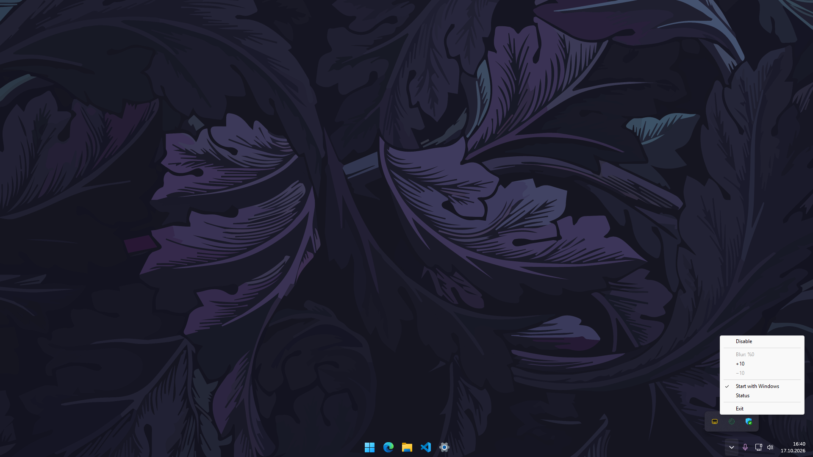

# Taskbar Customizer 1.0.0

A C++ application that makes the Windows taskbar transparent and lets you adjust
its background blur. The interface is in English; no third-party runtime packages are required.

## Usage

Click the system tray icon:

- **Enable / Disable:** Enables the effect or requests restoration of the previous appearance.
- **Blur, +10 / −10:** 0% is clear and transparent; 100% applies the strongest blur.
- **Start with Windows:** Launches the application when the current user signs in.
- **Status / Exit:** Shows the application status or closes the application.

Blur and effect preferences are stored in
`%LOCALAPPDATA%\TaskbarCustomizer\settings.json`. On first launch, the effect is
disabled and blur is set to 0%. Exit does not change saved preferences.

## Building

Requires Windows x64, an MSVC compiler with C++20 support, the Windows SDK, and CMake 3.24+.
Install **Desktop development with C++** and **C++ CMake tools for Windows**
through Visual Studio or Build Tools.

1. Close any running instance using **Exit**. If the DLL is loaded, save your work and restart Windows Explorer.
2. Run `build.bat`.
3. Open `_build/Release/TaskbarCustomizer.exe`.

Keep `TaskbarCustomizerXaml.dll` in the same folder as the EXE. The build script
does not launch the application automatically. Disable **Start with Windows**
before moving or deleting the application.

## Limitations

The application targets the modern Windows 11 taskbar; Windows updates may affect
compatibility. The DLL runs inside Explorer and remains loaded until Explorer exits.
The GPU cost of blur depends on your hardware and displays.
See [SECURITY.md](SECURITY.md) for details about the application's security-related behavior.
